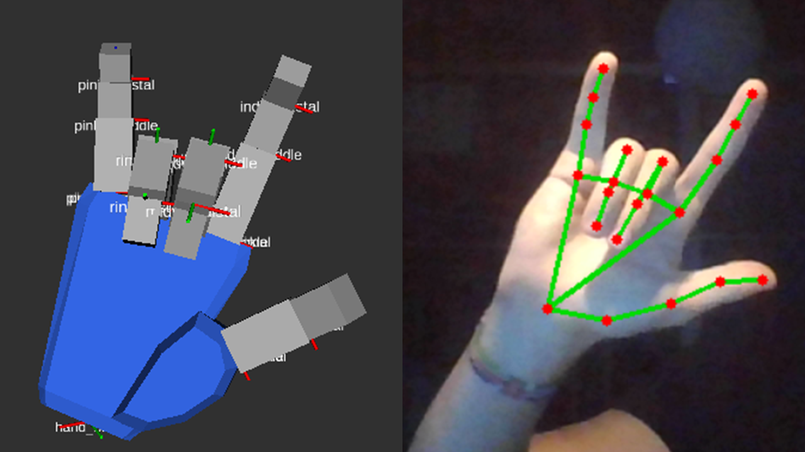

# Robotic hand visualization

<p align="center">
  
</p>

Build and run from this workspace:

```bash
source /opt/ros/jazzy/setup.bash
colcon build --symlink-install
source install/setup.bash
ros2 launch hand_control visualize.launch.py
```

RViz uses `palm` as its fixed frame. All 14 joints start open, reach their
URDF upper limits after four seconds, and return open after eight seconds.
The publisher reads limits from the same Xacro as robot_state_publisher and
publishes `/joint_states` at 20 Hz. The default sweep respects the model's
velocity limits. Shorter periods that exceed those limits are rejected.

Launch options:

```bash
ros2 launch hand_control visualize.launch.py rviz:=false
ros2 launch hand_control visualize.launch.py period:=12.0
ros2 launch hand_control visualize.launch.py test_motion:=false
```

Disable test motion when supplying joint states from another source. With
`test_motion:=false`, moving-link transforms require an external publisher.
Run the demo in a separate ROS domain if the arm workspace is running too,
because both use `/joint_states` and `/robot_description`.

RViz requires a working graphical display (for example WSLg).
No webcam, MediaPipe, TCP, physics, or motor interface is involved.

Validation:

```bash
colcon test --event-handlers console_direct+
colcon test-result --verbose
```

## TCP hand control

After rebuilding and sourcing the workspace, run:

```bash
ros2 launch hand_control tcp_visualize.launch.py
# Headless:
ros2 launch hand_control tcp_visualize.launch.py rviz:=false
# Receiver alone:
ros2 run hand_control webcam_receiver
```

The separate TCP launch disables the demonstration publisher automatically.
Stop an already-running demo before starting TCP control. The arm workspace
and its port 8765 are unchanged; the hand listens on **127.0.0.1:8766**.
Keep arm and hand in separate ROS domains when running their visualizations
simultaneously, as described above. No arm package needs to be sourced.

Send ASCII CSV with exactly 14 finite **degree** values per line, terminated
by LF (`\n`; CRLF is also accepted). The fixed field order is:

```text
index_mcp,index_pip,index_dip,middle_mcp,middle_pip,middle_dip,ring_mcp,ring_pip,ring_dip,pinky_mcp,pinky_pip,pinky_dip,thumb_base,thumb_ip
```

Do not send the header. Zero means open; positive values curl the fingers.
These are joint flexion values, not raw anatomical interior angles.
For example, this synthetic client can run with ordinary Python on Windows:

```python
import socket
import time

with socket.create_connection(('127.0.0.1', 8766)) as connection:
    for degrees in (0, 45, 0):
        message = ','.join([str(degrees)] * 14) + '\n'
        for _ in range(40):
            connection.sendall(message.encode('ascii'))
            time.sleep(0.05)
```

The receiver converts to radians and clamps to Xacro position limits. It
smooths all joints at 20 Hz (`alpha=0.2`) and limits each update to the URDF
velocity bound. Invalid frames never partially update a pose. Frames longer
than 4096 bytes are discarded through their next newline. One client is
served at a time; subsequent connections are accepted after disconnection.

Before the first valid sample, the model stays open. After disconnection or
one second without a valid sample, it holds the current published pose and
logs a warning. A new valid sample resumes motion. This is visualization
behavior, not a hardware emergency-stop implementation.

TCP launch parameters include `model`, `rviz`, `host`, `port`, `alpha` (0–1,
excluding zero), and `stale_timeout` (positive seconds), for example:

```bash
ros2 launch hand_control tcp_visualize.launch.py rviz:=false alpha:=0.3 stale_timeout:=0.5
```

No MediaPipe or webcam capture is included. Only Python's standard library
and the package's existing ROS dependencies are needed for the receiver.

After the usual unit tests, exercise real sockets and ROS/TF publication:

```bash
python3 src/hand_control/test/tcp_smoke.py
```

This smoke test temporarily uses ROS domain 89 and port 8766; stop any hand
receiver first. It tests fragmented/coalesced and malformed frames, buffer
recovery, stale/disconnect holds, reconnection, and clean shutdown.

## Wrist orientation

The optional wrist receiver adds a dynamic `hand_base -> palm` transform while
retaining the 14 finger joints and unchanged URDF. After rebuilding:

```bash
ros2 launch hand_control wrist_visualize.launch.py rviz:=false
python3 src/hand_control/test/tcp_smoke.py --wrist
```

Both commands run without RViz. Use the Windows sender's `--wrist` flag for
version-2 JSON; legacy CSV remains accepted and holds the wrist. Stop other
hand receivers first. See [the webcam guide](../robot_webcam/README_HAND.md#wrist-orientation-optional)
for neutral capture, coordinate conventions, limitations, and tuning parameters.

## Finger spread and palm shape

The hand now has 18 movable joints: 14 existing flexion joints plus four
`*_spread` joints at the finger knuckles. The wrist sender supplies optional
`finger_spread_deg` in v2 JSON; CSV stays at 14 values and uses zero spread.
The blue, tapered palm mesh with bevelled edges replaces the box and is installed with the description
package. Rebuild and restart the launch to load the new model. See the webcam
guide's finger spread section for limits, retargeting, and remaining degrees
of freedom.

The latest model also includes `thumb_spread` (19 movable joints total).
The wrist sender supplies optional `thumb_spread_deg` for sideways opening,
independently of `thumb_base` and `thumb_ip`. Rebuild and restart the hand
launch after this model update.

The blue palm now also carries a separate thenar (thumb-base) pad. The original
palm mesh is unchanged. The thumb attaches at the pad's outer end; proximal
and distal widths are 22 mm and 20 mm. The pad generator is included as
`meshes/generate_thumb_pad.py` in the description package. Joint names,
tracking conventions, and motion limits are unchanged.

The current thumb base is articulated by `thumb_opposition` (20 joints total).
It carries the blue `thenar` link, `thumb_spread`, and both thumb bend joints.
The original main palm mesh and neutral pad/thumb placement are preserved.
The wrist sender supplies optional `thumb_opposition_deg`; the preview calls
this `Thumb inward`. See the webcam guide for the geometric approximation.
